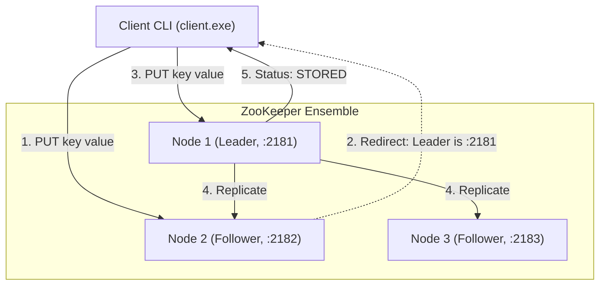

# ZKeeper

A distributed coordination service and replicated in-memory Key-Value store built with **C++17**, **gRPC**, and **Protocol Buffers**, inspired by Apache ZooKeeper and the Raft consensus algorithm.

---

## Table of Contents

- [Overview](#overview)
- [Architecture & Features](#architecture--features)
- [Project Structure](#project-structure)
- [Prerequisites & System Requirements](#prerequisites--system-requirements)
- [Installation & Dependency Setup](#installation--dependency-setup)
- [Building the Project](#building-the-project)
- [Running the System](#running-the-system)
  - [Method 1: Automated Cluster Scripts](#method-1-automated-cluster-scripts)
  - [Method 2: Manual Step-by-Step Execution](#method-2-manual-step-by-step-execution)
- [Client Usage & Commands](#client-usage--commands)
- [Demonstrating Fault Tolerance (Failover)](#demonstrating-fault-tolerance-failover)
- [Pre-Flight Checklist & Troubleshooting](#pre-flight-checklist--troubleshooting)

---

## Overview

ZKeeper implements a distributed coordination cluster capable of:
1. **Dynamic Leader Election**: Elects a single leader across the ensemble using term-based voting and randomized heartbeats.
2. **Distributed Data Replication**: Linearizes write requests (`PUT`) through the elected leader and synchronously replicates to all peer nodes.
3. **Smart Client Routing & Failover**: The interactive client can connect to any ensemble node, automatically detect cluster topology, follow leader redirects, and fail over to surviving nodes if the active node or leader crashes.

---

## Architecture & Features



- **Raft-Inspired Leader Election**:
  - Node states: `FOLLOWER`, `CANDIDATE`, `LEADER`.
  - Randomized election timeout window (`1800ms` - `3200ms`) to prevent split-vote scenarios.
  - Heartbeat interval: `500ms` from leader to followers.
  - Majority quorum rule: Node must obtain votes from more than `N / 2` nodes to become leader.
- **Replication & Consistency**:
  - Thread-safe in-memory key-value engine (`KVStore`) with mutex guards.
  - Write requests (`PUT`) must go to the leader. Followers reject client writes with a redirect header pointing to the current leader.
  - Read requests (`GET`) can be served locally by any node.
- **Cluster Discovery**:
  - Nodes exchange peer lists via the `CLUSTER` RPC (`NODES <host:port> ...`).
  - The client dynamically queries nodes to build the cluster view from a single bootstrap address.

---

## Project Structure

```
ZKeeper/
├── CMakeLists.txt        # CMake build configuration
├── README.md             # Project documentation (this file)
├── node.proto            # gRPC protocol definition (source in proto/)
├── proto/
│   └── node.proto        # Protocol Buffers schema (Coordinator & Node services)
├── node/
│   ├── zookeeper.cpp     # ZooKeeper cluster server implementation
│   ├── client.cpp        # Interactive CLI client
│   ├── kv_store.h        # Thread-safe in-memory key-value store
│   └── server.cpp        # Standalone worker node implementation
└── srcipts/              # Helper batch scripts for Windows
    ├── build.bat         # Triggers cmake build
    ├── run_cluster.bat   # Automated multi-node ensemble and client launcher
    └── close_cluster.bat # Process termination utility
```

> **Note:** The scripts folder is named `srcipts/` in the repository.

---

## Prerequisites & System Requirements

Before you can build and run ZKeeper, ensure the following are installed:

| Component | Minimum Version | Description |
| :--- | :--- | :--- |
| **Operating System** | Windows 10/11 (or Linux/macOS) | Tested primarily on Windows 64-bit |
| **C++ Compiler** | C++17 compatible | **Visual Studio 2022** (MSVC v143+) or GCC 9+ / Clang 10+ |
| **Windows SDK** | Windows 10/11 SDK | Required by MSVC for CRT headers (`crtdbg.h`, `float.h`) |
| **CMake** | 3.20 or newer | Build configuration generator |
| **Package Manager** | [vcpkg](https://github.com/microsoft/vcpkg) | Used to manage and link `gRPC` and `Protobuf` |
| **Git** | Latest | Required to clone and bootstrap vcpkg |

---

## Installation & Dependency Setup

### 1. Install Visual Studio 2022 (with C++ and Windows SDK)
1. Download the **Visual Studio Installer** from [visualstudio.microsoft.com](https://visualstudio.microsoft.com/).
2. Select **Desktop development with C++**.
3. In the right-hand *Installation details* pane, ensure the following are checked:
   - **MSVC v143 - VS 2022 C++ x64/x86 build tools**
   - **Windows 10 SDK** or **Windows 11 SDK** (e.g., `10.0.22621.0` or newer)
   - **C++ CMake tools for Windows**

### 2. Install and Bootstrap `vcpkg`
If you do not already have `vcpkg` installed:

```powershell
# In PowerShell or Command Prompt (e.g., in your user directory C:\Users\<Username>\):
git clone https://github.com/microsoft/vcpkg.git
cd vcpkg
.\bootstrap-vcpkg.bat
```

*(Optional but recommended)* Integrate vcpkg into your user environment:
```cmd
vcpkg integrate install
```

### 3. Install gRPC and Protocol Buffers via `vcpkg`
Install 64-bit Windows packages for Protobuf and gRPC:

```cmd
vcpkg install protobuf:x64-windows grpc:x64-windows
```

> **Note:** This will install Protobuf, gRPC, and their dependencies (Abseil, OpenSSL, c-ares, re2, zlib) and compile the `protoc` compiler and `grpc_cpp_plugin` tools. This may take 10-25 minutes depending on your hardware.

---

## Building the Project

### Method A: Standard CMake Build (Recommended)

1. Open **Developer Command Prompt for VS 2022** or **Developer PowerShell for VS 2022** (or standard shell with SDK environment loaded).
2. Navigate to the project root:
   ```cmd
   cd c:\Users\susha\Desktop\ZKeeper
   ```
3. Create and navigate into the `build` directory:
   ```cmd
   mkdir build
   cd build
   ```
4. Configure the project with CMake, specifying the path to your `vcpkg.cmake` toolchain file:
   ```cmd
   cmake .. -G "Visual Studio 17 2022" -A x64 -DCMAKE_TOOLCHAIN_FILE="C:/Users/susha/vcpkg/scripts/buildsystems/vcpkg.cmake"
   ```
   *(Replace `C:/Users/susha/vcpkg` with the location of your vcpkg installation if different)*.

5. Compile the targets:
   ```cmd
   cmake --build . --config Debug
   ```

Upon completion, the compiled binaries and required DLLs will be located in:
`build\Debug\`
- `ZooKeeper.exe`
- `Client.exe`
- (plus dependency DLLs: `abseil_dll.dll`, `cares.dll`, `libprotobufd.dll`, `zlibd1.dll`, etc.)

---

### Method B: Using `srcipts/build.bat`

If your build folder has already been configured once with CMake:
```cmd
.\srcipts\build.bat
```
*(Ensure the path inside `build.bat` matches your workspace directory).*

---

## Running the System

### Method 1: Automated Cluster Scripts

The repository includes ready-to-run automation scripts inside `srcipts/`:

#### Step 1: Start the Cluster
Double-click or run from terminal:
```cmd
.\srcipts\run_cluster.bat
```
- It prompts: `How many ZooKeeper servers do you want to start?`
- Enter `3` (recommended for a standard quorum).
- The script automatically:
  1. Computes port numbers (`2181`, `2182`, `2183`).
  2. Launches each ZooKeeper instance in its own separate command prompt with appropriate peer lists.
  3. Waits 3 seconds for leader election to complete.
  4. Launches the interactive `Client.exe` window with the bootstrap addresses.

#### Step 2: Stop the Cluster
To cleanly stop all cluster and client windows:
```cmd
.\srcipts\close_cluster.bat
```

---

### Method 2: Manual Step-by-Step Execution

If you prefer launching each node manually in separate terminals:

#### Terminal 1: Node 1 (Port 2181)
```cmd
cd build\Debug
ZooKeeper.exe 2181 localhost:2182 localhost:2183
```

#### Terminal 2: Node 2 (Port 2182)
```cmd
cd build\Debug
ZooKeeper.exe 2182 localhost:2181 localhost:2183
```

#### Terminal 3: Node 3 (Port 2183)
```cmd
cd build\Debug
ZooKeeper.exe 2183 localhost:2181 localhost:2182
```

#### Terminal 4: Client
```cmd
cd build\Debug
Client.exe localhost:2181 localhost:2182 localhost:2183
```

---

## Client Usage & Commands

Once the `Client.exe` is running, you will see the `zk>` prompt:

```
[Client] Added node: localhost:2181
[Client] Added node: localhost:2182
[Client] Added node: localhost:2183
[Client] Cluster discovered: localhost:2181 localhost:2182 localhost:2183
zk> 
```

### Available Commands

| Command | Syntax | Description | Example |
| :--- | :--- | :--- | :--- |
| **PUT** | `PUT <key> <value>` | Stores a key-value pair. Redirects automatically to the leader if connected to a follower. | `PUT username alice` |
| **GET** | `GET <key>` | Retrieves the value of a key. | `GET username` |
| **REFRESH** | `REFRESH` | Re-queries the cluster for the list of active member nodes. | `REFRESH` |
| **help** | `help` | Displays the list of available commands. | `help` |
| **exit** | `exit` | Closes the client connection and exits. | `exit` |

### Example Session

```text
zk> PUT user:1001 Bob Smith
Response: STORED

zk> GET user:1001
Response: VALUE: Bob Smith

zk> GET non_existent_key
Response: ERROR: NOT FOUND

zk> REFRESH
[Client] Cluster updated

zk> exit
Exiting...
```

---

## Demonstrating Fault Tolerance (Failover)

To verify the distributed leader election and consensus mechanisms:

1. Start 3 ZooKeeper instances (`2181`, `2182`, `2183`).
2. Watch the terminal logs to identify which node prints:
   ```
   [ZooKeeper localhost:<port>] Became leader for term 1
   ```
3. Issue a write from the client:
   ```text
   zk> PUT config_version 42
   Response: STORED
   ```
4. **Simulate a crash**: Close the console window of the **leader node**.
5. Observe the remaining 2 followers:
   - Their election timers expire (`> 1800-3200ms`).
   - One node triggers `startElection()`, requests votes, achieves a majority quorum (`2/3`), and becomes the new leader for `term 2`.
6. Issue a read or write from the client:
   ```text
   zk> GET config_version
   Response: VALUE: 42
   ```
   *The client automatically falls back, redirects to the new leader, and maintains data consistency!*

---

## Pre-Flight Checklist & Troubleshooting

### 1. `error C1083: Cannot open include file: 'float.h' / 'crtdbg.h': No such file or directory`
- **Cause:** Visual Studio cannot locate the Windows 10/11 Universal CRT (UCRT) SDK headers.
- **Fix:** 
  1. Open Visual Studio Installer.
  2. Click **Modify** on your Visual Studio 2022 installation.
  3. Under **Individual components**, search for and select **Windows 11 SDK** (or **Windows 10 SDK**) and **MSVC v143 C++ x64/x86 build tools**.
  4. Complete the installation and re-run CMake inside a **Developer Command Prompt for VS 2022**.

### 2. Missing DLLs (`libprotobufd.dll`, `abseil_dll.dll`, etc.)
- When configuring with `-DCMAKE_TOOLCHAIN_FILE=".../vcpkg.cmake"`, CMake automatically configures `VCPKG_APPLOCAL_DEPS` to copy the DLLs directly next to `ZooKeeper.exe` and `Client.exe` in `build/Debug/`.
- If running binaries manually from outside the `build/Debug` directory, ensure the `vcpkg/installed/x64-windows/bin` or `debug/bin` directory is added to your system `PATH`.

### 3. Port Conflicts (`Failed to start ZooKeeper on 0.0.0.0:2181`)
- Verify whether previous instances are still running using `srcipts/close_cluster.bat` or checking in PowerShell:
  ```powershell
  Get-Process ZooKeeper, Client -ErrorAction SilentlyContinue | Stop-Process
  ```
- Alternatively, modify the base port numbers in `srcipts/run_cluster.bat` or supply different ports manually.

### 4. Windows Defender / Firewall Prompt
- On the first run, Windows Firewall may request permission to allow `ZooKeeper.exe` and `Client.exe` to communicate on local networks. Select **Allow access** (Private networks) to allow local gRPC sockets to connect.
